<p align="center">
  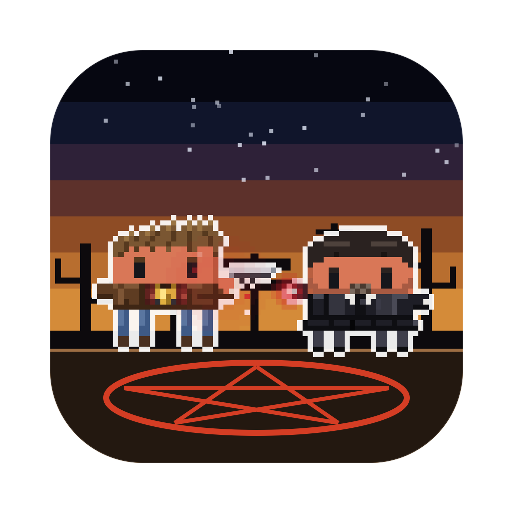
</p>

<h1 align="center">Superclawdtural</h1>

<p align="center">
  <b>Your AI coding sessions, as a pixel-art hunt on your desktop.</b><br>
  Every session is a hunter or a monster, every subagent joins the family business, and they fight while they work.
</p>

<p align="center">
  <a href="LICENSE"></a>
  
  
  
  <a href="https://github.com/rodclemen/clawd-clash"></a>
</p>

<!-- The trailer: the 720p copy (promo/720p/Superclawdtural.mp4 in Clawd Clash) goes here once it's uploaded to GitHub. -->

<p align="center"><sub>🔊 <b>Click the speaker in the player for sound</b>: GitHub starts videos muted. Full 1080p version: <a href="promo/superclawdtural-promo.mp4">promo/superclawdtural-promo.mp4</a></sub></p>

> **Superclawdtural is a universe of [Clawd Clash](https://github.com/rodclemen/clawd-clash).** Same crew, same fights, more universes to switch to. This page shows off the Superclawdtural universe; see [Get it](#get-it) to install.

<p align="center">
  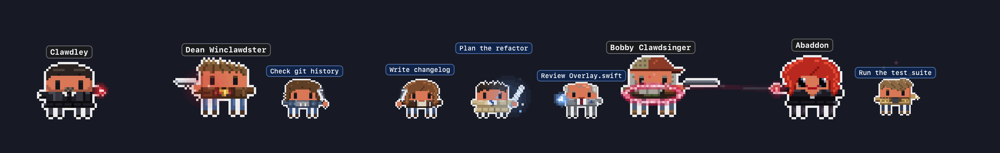
</p>

---

## Contents

- [What it is](#what-it-is)
- [The Superclawdtural universe](#the-superclawdtural-universe)
- [The cast](#the-cast)
- [Window mode](#window-mode)
- [Screen saver](#screen-saver)
- [Get it](#get-it)
- [More universes](#more-universes)
- [What's new](#whats-new)

## What it is

You run Claude Code in three terminals. One is thinking, one is waiting for your permission, one finished ten minutes ago and you didn't notice. You alt-tab around to find out.

**Clawd Clash tells you at a glance, without switching windows.** Every session becomes a character in a pixel-art hunt, along the bottom of your screen or in a window of its own: Claude Code's, and those of the other AIs and harnesses Clawd Clash supports ([the full list](https://github.com/rodclemen/clawd-clash#supported-ais-and-harnesses)).

- ⚔️ **Working?** Your Claude fires a shotgun loaded with rock salt, swings a machete or an angel blade, or throws a demon's power from a raised hand.
- 💭 **Thinking?** A thought bubble.
- ❗ **Needs you?** A red `!`, and if you ignore it for a minute, it starts jumping up and down. It keeps asking until you answer; press Esc instead and it stands down.
- 😴 **Done and idle?** It stops fighting and passes the time with habits of its own: Dean eats a slice of cherry pie, the hunters spray-paint a devil's trap on the floor and check it holds, the angels practise with their blades, and Clawdstiel turns up somewhere he shouldn't. Nobody here floats cross-legged in meditation. After a couple of minutes it sits down; after five it's asleep (zZz).
- 🚗 **Spawned subagents?** Every subagent gets to join the hunt: they walk in one by one, each labelled with what it's doing, and leave when they finish.
- 🔍 **Hover** any character for the details: status, how long, the tool it's running, your last prompt.
- 🖱️ **Click** any of them to jump straight to that session's terminal or editor tab.

No dashboard to open, no tab to check. It's just… there. Saving people. Hunting bugs. The family business.

## The Superclawdtural universe

Run two Claudes and they square off. Every character is Clawd (Claude Code's little pixel mascot) in costume, from all fifteen seasons of Supernatural, and the fights follow the weapons:

| Matchup | What happens |
|---|---|
| a power (the archangels' white light, Clawdley's red, Azazel's yellow rings, Rowena's red sparks, Abaddon's grip, Death's grey touch) vs a gun | the shooter gets hit |
| a power vs a blade, a knife, a lance or a scythe | the blade catches it |
| a gun (Dean's Colt M1911, John's Colt, Bobby's rock-salt shotgun, Ellen's pump-action, Jo's throwing knives, the FBI's Glock) vs a blade | shots fly, and each one gets knocked away into the sky |
| a blade vs a blade (Sam's demon-killing knife, the angel blades, the First Blade, Gordon's machete, Billie's scythe, the Lance of Michael) | they close in and fight it out |
| a gun vs a gun | a proper shoot-out: they duck and the shots collide mid-air |
| odd one out | cheers the others on |

Some of them don't fight at all: Henry Winclawdster, Ash, Kevin Tran, Ed and Harry of the Ghostfacers, Frank Devereaux, Missouri Mosley, Pamela Barnes, Becky Rosen, Tessa, Eve, Famine and the Crossroads Demon.

**Arch-enemies face off first.** Whenever a pair is on stage together, everyone else shuffles aside so the two of them can have it out: Dean and Michael, Sam and Lucifer, Clawdstiel and Metatron, Jack and Chuck, John and Azazel, Bobby and Clawdley, Charlie and Dick Roman, Gabriel and Asmodeus, Henry and Abaddon, Mary and Lady Toni Bevell, Kevin and Gadreel, Benny and Eve, Henriksen and Lilith, and Mick Davies and Arthur Ketch. Death and Billie never lead two sessions back to back: one Death at a time.

**Baby.** When an agent is done, it doesn't walk off: the '67 Impala drives in along the ground, headlight lit and hubcaps turning. She stops, the rear door swings out for whoever's leaving, the trunk lid swings up on the arsenal in the trunk light (the salt, a pump shotgun, the machete), and they're gone down the road. Everyone rides in Baby.

<p align="center">
  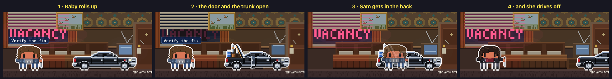
</p>

**Back from Hell.** The Winclawdsters never stay dead. When a session led by Dean, Sam, Clawdstiel, Bobby or Jack compacts its context, hellhound claws rake red scratches across the ground and drag them under in a red glow. A moment later a fist punches up through the dirt, they climb out, dust themselves off, and BACK FROM HELL comes up over them.

<p align="center">
  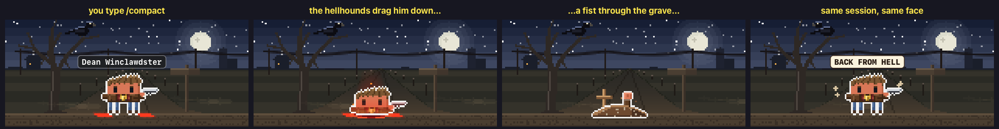
</p>

**Personal space.** Now and then Clawdstiel vanishes in a flutter of wings, a few feathers drifting down where he stood, and turns up right behind the nearest hero, far too close: "Hello, Dean." If it is Dean, he turns round and says so. A few seconds later Clawdstiel flutters back to his spot.

<p align="center">
  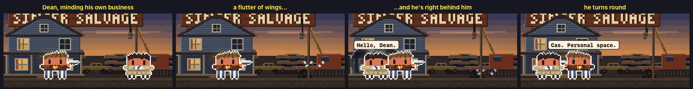
</p>

**"Bitch." "Jerk."** With Dean and Sam both on stage and standing about, now and then Dean turns to his brother and says it, and Sam answers a beat later.

<p align="center">
  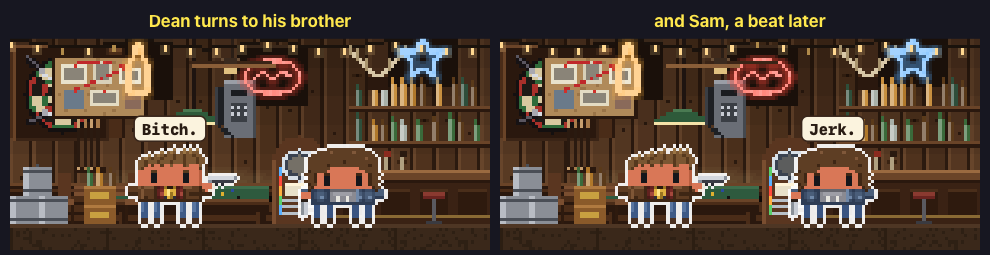
</p>

**Practice.** Between jobs the hunters lay a devil's trap: a spray can shaken till it rattles, the ring, the star and the sigils painted stroke by stroke, a step back and two nods, and a boot scuffs it out for the next go. The angels run through their strikes with their angel blades, and on the last thrust their wings' shadow flares across the wall.

<p align="center">
  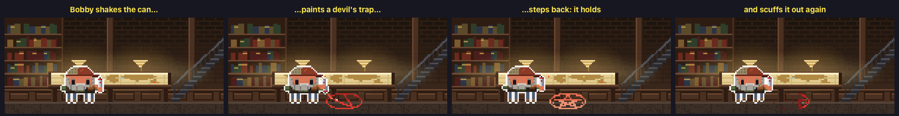
  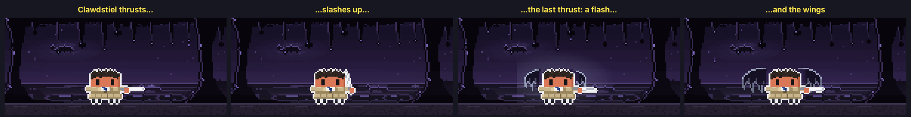
</p>

**Abaddon's grip.** She doesn't throw anything. Her arm goes out, her fist clenches and glows, and whoever she's fighting is hauled off the ground, kicking, a crimson coil squeezing round their middle, her eyes black while she holds them.

<p align="center">
  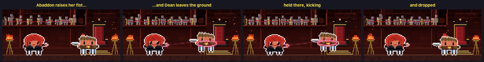
</p>

**Heroes against villains.** Run Claude Code alongside another AI and they pick sides: Claude Code plays the hunters and their friends, the others the demons, angels and monsters, and each one's agents fight for their own side. The outline colour round each character tells you which AI it belongs to.

## The cast

45 villains and 34 heroes (plus one rare guest), from all fifteen seasons. Nearly all of them can be a session (drawn large) or an agent (drawn small); Miracle the dog, a hellhound, a Leviathan blob and a wisp of demon smoke only ever come as agents. Most have a signature move, and many an arch-enemy.

**The heroes**: the Winclawdsters: Dean in his leather jacket and the amulet (pulls out a slice of cherry pie and takes three huge bites), Sam (opens his laptop, types away, closes it and sweeps his hair out of his eyes), Mary (pushes her hair back, drops the clip out of her pistol to check it and slaps it home), John (writes in his battered hunting journal), Henry in his fedora (tips it, then holds up the Men of Letters key) and Jack (his eyes glow gold, then he grins and eats a bar of nougat); the angels on their side: Clawdstiel in his trench coat (the lights dim and his wings show as a shadow on the wall), Gabriel the Trickster (snaps his fingers and there's a candy bar in his hand), Balthaclawds (sips his red wine while his wings' shadow spreads behind him) and Tessa the reaper (holds out her hand, and a pale light gathers in it); the hunters: Bobby Clawdsinger (a swig from his flask of holy water), Ellen Harvell (racks her pump shotgun, a red shell spinning out), Jo Harvell (a dartboard hops out from behind her and she throws a knife into the bullseye), Rufus Turner (pours himself a glass of the good stuff), Garth Fitzclawd IV (Mr. Fizzles, his sock puppet, pops up and chats away), Claire Novak (spins her machete round her hand and catches it), Eileen Leahy (signs "hi" with a big wave), Benny Lafitte (his vampire fangs slide down, and back up), Mick Davies of the British Men of Letters and Charlie Clawdbury (raises her LARP sword as Queen of Moondoor, a little gold crown on her head); the Roadhouse's Ash (his laptop's lights blink and chase); Sheriff Jody Mills (flips open her badge), Sheriff Donna Hanscum of Stillwater (eats a pink-frosted donut in three happy bites) and Alex Jones; Kevin Tran (lifts the Word of God and reads it as it blazes); Rowena MacClawd (tosses a hex bag that bursts in red sparks); the Ghostfacers, Ed Zedmore (starts recording) and Harry Spangler (his EMF meter hits the red and his hair stands on end); Frank Devereaux (snaps a SIM card in half); the psychics Missouri Mosley (swats a cheeky little ghost away) and Pamela Barnes (holds a séance, candles flaring round her); Becky Rosen (hugs one of Carver Edlund's books, hearts floating up); Agent Victor Henriksen (flips open his FBI badge); and Miracle the dog (chases his tail). And now and then HEM turns up as a hunter, in a red flannel shirt, Dean's amulet and a trucker cap, with a sawn-off shotgun loaded with rock salt.

**The villains**: the demons: Clawdley, King of Hell (snaps his fingers in a red flash, and the shadow of Juliet, his hellhound, sits at his heel), Azazel (his yellow eyes flash), Meg Masters (her eyes flick black), Ruby (twirls her knife), Lilith, Alastair, Abaddon (closes her hand slowly into a fist), Cain (bees pour out of his hand and swirl round him), Asmodeus (twirls his cane), Dagon (a flame blooms in her palm), Ramiel (leans his lance away and goes fishing), Demon Dean with the Mark of Cain (karaoke, eyes shut, singing his heart out) and the Crossroads Demon (buries a little tin box at the crossroads); the angels: Lucifer, Michael and Raphael (their wings' shadow thrown across the wall), Zachariah (shoots his cuff and checks his watch), Metatron (types a page on his old typewriter), Uriel, Naomi and Gadreel; the Big Bads: Dick Roman (his grin splits into a Leviathan's mouth full of teeth), Chuck (swings his guitar round and strums it), Amara (black mist swirls up round her), Eve (a little monster crawls out of her hand and scuttles off) and Billie (turns over an hourglass and watches the sand run); the Horsemen: War (turns his ring, red ripples spreading), Famine (breathes in a green mist), Pestilence (coughs a green cloud into his hanky) and Death (eats a chili dog with a knife and fork); the British Men of Letters, Lady Toni Bevell and Arthur Ketch (straightens his tie); Gordon Walker (hones his machete across his front, sparks off the tip) and Bela Talbot; and the monsters of the week: the Alpha Vampire, Bloody Mary (vanishes into her mirror and looks out of it), the Woman in White (flickers down the road and back), the Hookman (scrapes his hook along the ground in sparks), a Shapeshifter (his eyes flash silver), a Djinn (his tattoos light up blue), the Clown (honks his nose) and the Scarecrow (turns his head all the way round). And the small fry, only ever agents: a hellhound, a Leviathan blob and a wisp of demon smoke.

<p align="center">
  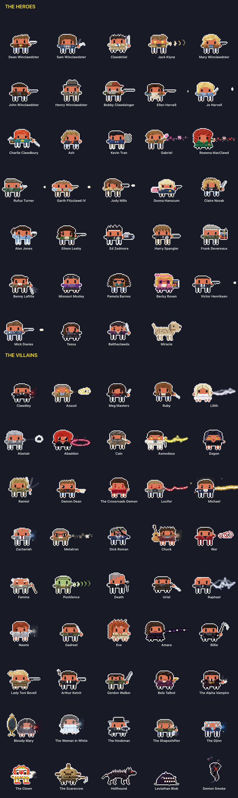
</p>

## Window mode

Clawd Clash opens in a window by default (switch to the desktop from the menu). The whole crew stands in a scene, and every session gets a card: its project, what it's doing right now, your last prompt, its last reply, and its agents in a little tree underneath.

<p align="center">
  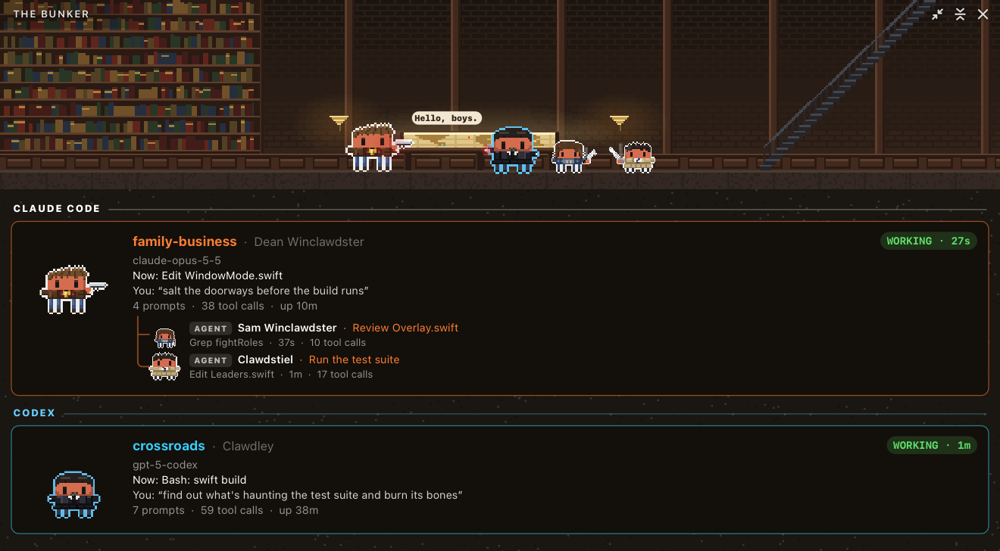
</p>

The scene is set **where the first session's character belongs**: the Bunker for Dean, Sam, Clawdstiel and Jack, Singer Salvage for Bobby, the Roadhouse for Ellen, Jo and Ash, the house in Lawrence for John and Mary, the crossroads for its demons, Clawdley's Hell for Clawdley, Heaven for the angels, Purgatory for Benny and the monsters, Jody's house in Sioux Falls for the sheriffs and their girls.

20 hand-built places, each with its own little animation: the map table's lights pulse in the Bunker's war room; the crane's hook sways over the stacks of crushed cars at Singer Salvage; the neon beer signs flicker at Harvelle's Roadhouse; the VACANCY sign blinks through the blinds of a motel room; one window flickers upstairs in the house in Lawrence, Kansas; a crow shifts on the dead tree at the crossroads; lightning flashes over Stull Cemetery; the queue shuffles forward in Clawdley's Hell; leaves fall in Heaven; eyes blink between the trees in Purgatory; black goo drips in the Empty; headlights pass on the open road at night, the Impala's trunk open on the arsenal; a flashlight beam sweeps Roosevelt Asylum; coffee steams in a roadside diner; the city twinkles below Roman Enterprises; ash falls on Apocalypse World; the flags flap at Moondoor; the scarecrow sways in the orchard at sunset; pages stir on Chuck's desk; and the clock ticks in Jody's kitchen in Sioux Falls.

<p align="center">
  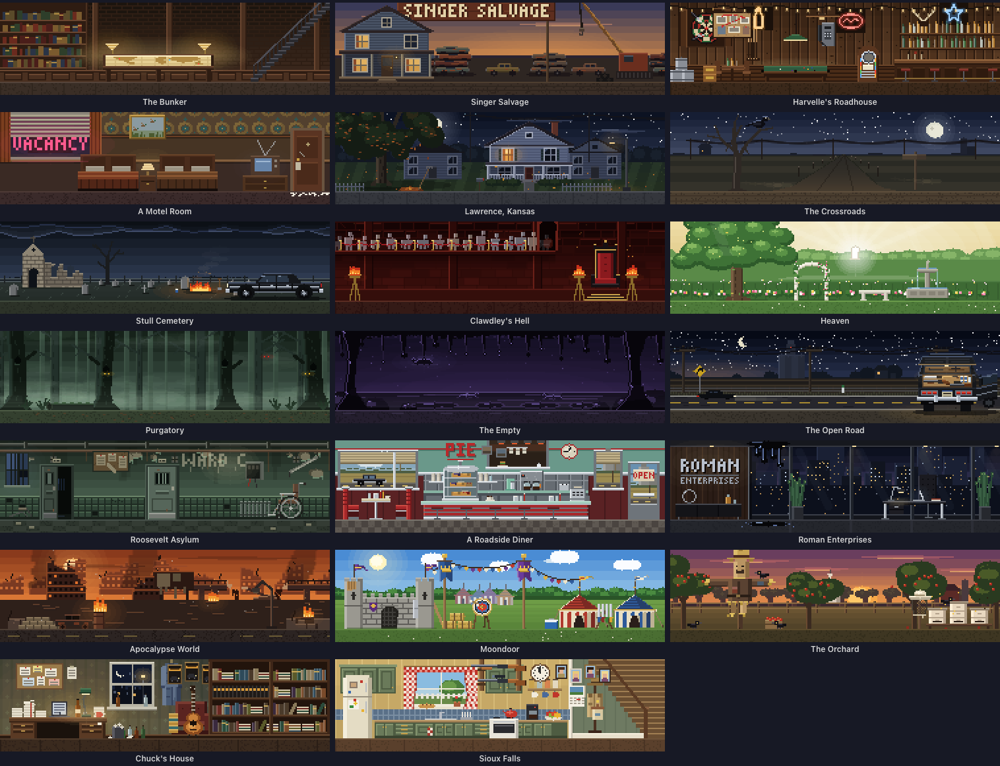
</p>

When the scene moves somewhere new, it goes the way the show would: the Impala's headlights sweep the new place into view; flames rise from the bottom like a grave being salted and burned; a red devil's trap paints itself on and spins open; a column of demon smoke bursts up, thrashes and pours into the new place; the bulbs pop and an angel's wing shadows spread in blinding light; hellhound claws rip across the old place; frost creeps in from the corners of a cold spot and cracks away; the Ghostfacers' camcorder records a ghost flickering past; the motel's wallpaper tiles across in loud patterns and peels off strip by strip; with Dick Roman about, a Leviathan's grin splits the old place open; with Chuck about, the old place becomes a page of the novels and is typed out again; and, rarest of all, The Road So Far, on grainy film, all the way to NOW. Each comes up more often with its own people on screen, or when it's heading for its own part of the map.

<p align="center">
  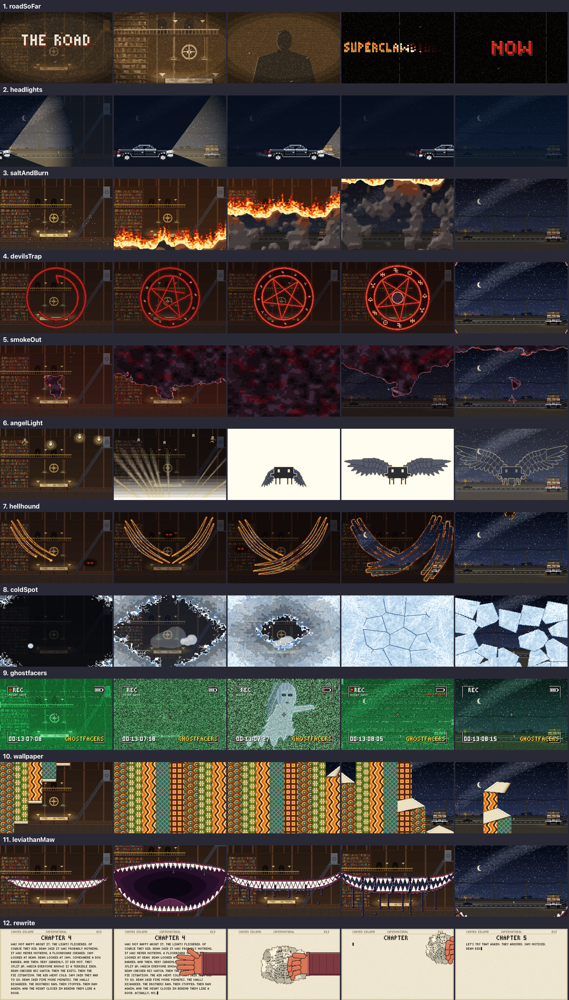
</p>

## Screen saver

<p align="center">
  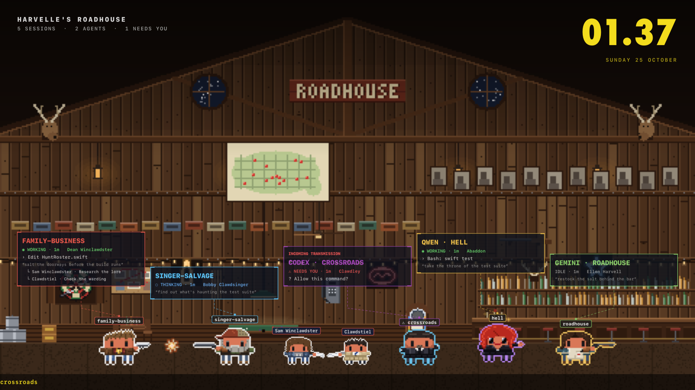
</p>

Clawd Clash comes with a screen saver: the place at full screen and the crew fighting across its floor. Every Claude and agent wears a name tag, each session has a card floating above the crew, a clock sits in the corner, and what happened lately crawls along the bottom. To keep your work private from anyone walking past, turn the cards and the banner off: the characters stay. Every 10 minutes it travels somewhere new with one of the transitions above. When there's nothing much to watch, it puts on a show instead: a random crew squaring off, heroes against villains. It even shows your sessions with the app closed. Pick **Superclawdtural** in the screen saver's **Options…** in System Settings.

The window can show the same view, and **Random** location moves the window somewhere new every 10 minutes, the same way.

## Get it

Superclawdtural is part of **[Clawd Clash](https://github.com/rodclemen/clawd-clash)**, one app with multiple universes. It needs macOS 13+ and at least one of the [AIs and harnesses it supports](https://github.com/rodclemen/clawd-clash#supported-ais-and-harnesses).

It's coming in Clawd Clash 4.1.0. With Homebrew:

```sh
brew tap rodclemen/tap
brew trust rodclemen/tap      # newer Homebrew asks you to trust a third-party tap once
brew install --cask clawd-clash
```

Then pick **Settings → Universe → Superclawdtural** (already have Clawd Clash? `brew upgrade --cask clawd-clash`). Or download the zip from [Clawd Clash's releases](https://github.com/rodclemen/clawd-clash/releases), unzip it and drag **Clawd Clash** to Applications.

Everything else (how it works, the settings, uninstalling, the source and contributing) lives in the **[Clawd Clash repo](https://github.com/rodclemen/clawd-clash)**.

## More universes

Superclawdtural is one of multiple universes. In **Settings → Universe** you can switch to **[Star Clawds](https://github.com/rodclemen/star-clawds)**, **[Marvelous Clawds](https://github.com/rodclemen/marvelous-clawds)**, **[Detective Clawds](https://github.com/rodclemen/detective-clawds)**, **[Doctor Clawd](https://github.com/rodclemen/doctor-clawd)**, **[The Clawd Files](https://github.com/rodclemen/the-clawd-files)**, **[Stevie Clawdberg](https://github.com/rodclemen/stevie-clawdberg)**, **[Clawd of the Rings](https://github.com/rodclemen/clawd-of-the-rings)**, **[Clawd Slayer](https://github.com/rodclemen/clawd-slayer)** or **[Stranger Clawds](https://github.com/rodclemen/stranger-clawds)**, or pick **Random** to change universe on its own every so often. Switching recasts everyone on screen and moves the scene to one of the new universe's places. Or pick **Clawd Royale** to throw every cast into one scene, each character as themselves, in a new place from any universe every ten minutes.

## What's new

The highlights, in plain words: [CHANGELOG.md](CHANGELOG.md). The full history lives in Clawd Clash.

---

<p align="center"><sub>An independent parody fan project, not affiliated with or endorsed by Warner Bros. Television, Kripke Enterprises, Wonderland Sound and Vision, The CW or the makers of Supernatural. Claude and Clawd belong to Anthropic.<br>Free to use: <a href="LICENSE">MIT licensed</a>.</sub></p>
